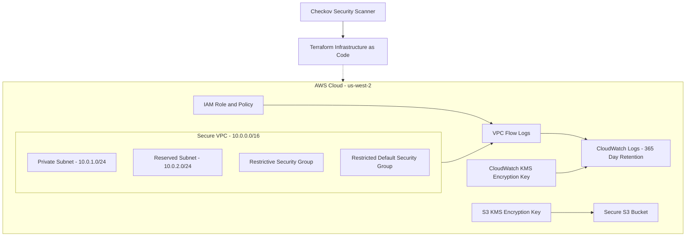

# AWS Secure Cloud Infrastructure Architecture

## Architecture Diagram

## Architecture Components

| Component | Purpose |
|---|---|
| Amazon VPC | Network isolation |
| Subnets | Network segmentation |
| Security Groups | Restrictive network access |
| Amazon S3 | Secure object storage |
| AWS KMS | Encryption and key management |
| AWS IAM | Access and permission management |
| VPC Flow Logs | Network traffic monitoring |
| Amazon CloudWatch | Centralized log storage |
| Terraform | Infrastructure as Code |
| Checkov | Static security analysis |

## Deployment Status

This architecture represents a locally validated Terraform configuration. No AWS resources have been deployed.

The reserved subnet does not currently have internet routing. The custom security group is not attached to a workload.
